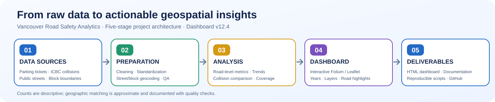
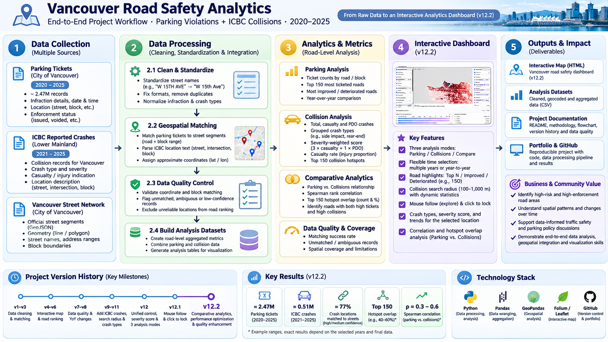
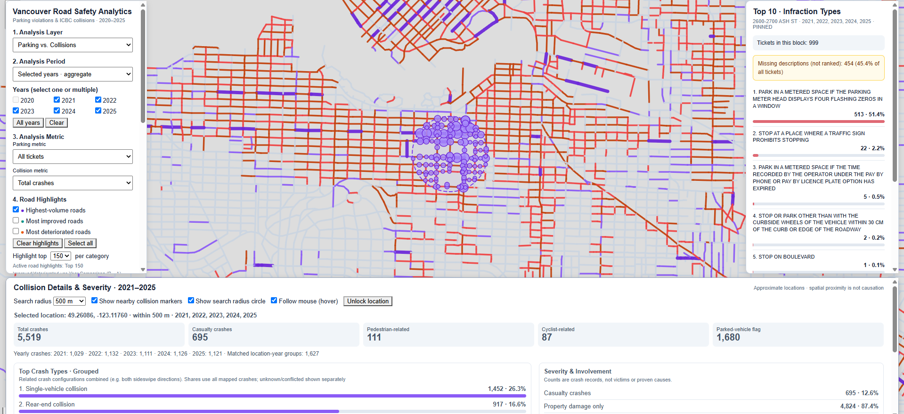

# Vancouver Road Safety Analytics

**End-to-End Geospatial Analytics · Python ETL · Interactive Road-Level Dashboard**

[**Explore the Live Dashboard**](https://lucis999.github.io/vancouver-road-safety-analytics/) · [**Download v1.0.0 Release**](https://github.com/Lucis999/vancouver-road-safety-analytics/releases/tag/v1.0.0) · [**Read the Case Study**](docs/PORTFOLIO_CASE_STUDY.md) · [**Methodology**](docs/METHODOLOGY.md)

**Public portfolio release:** `v1.0.0` · **Dashboard:** v12.4 · **Geography:** Vancouver, British Columbia · **Coverage:** Parking tickets 2020–2025; ICBC collisions 2021–2025

> **At a glance:** A reproducible Python-based workflow transforms municipal parking records, official road-network information and ICBC collision summaries into an interactive geospatial dashboard. Explore road-level patterns, annual changes, infraction composition and nearby approximate collision locations—without treating raw counts as measures of individual risk.

## Project architecture — the 30-second overview



The pipeline has five stages: **(1) collect official source data → (2) standardize, geocode and audit → (3) compute road-level measures → (4) visualize with Folium/Leaflet → (5) publish the dashboard, code and documentation.**

## Technical workflow — from raw records to an interactive map



*Detailed workflow infographic produced during the v12.2 development series. It illustrates the architecture and earlier milestones; the current public dashboard is **v12.4**. Figures marked as examples or ranges in the graphic are not independently verified v1.0.0 release metrics. Refer to the [methodology](docs/METHODOLOGY.md) and [quality documentation](docs/DATA_QUALITY.md) for authoritative implementation details.*

## Interactive dashboard preview

[](https://lucis999.github.io/vancouver-road-safety-analytics/)

*Actual dashboard view with a selected location and **500 m** search radius. The displayed collision totals refer to that selected location and period—not to the entire City of Vancouver. Click the screenshot to open the live, interactive dashboard.*

**[Launch the interactive dashboard →](https://lucis999.github.io/vancouver-road-safety-analytics/)**

### What you can explore

| Area | Interactive capabilities |
| --- | --- |
| **Parking violations** | Counts, coded statuses, infraction composition and road-level concentration |
| **Collision analysis** | ICBC crash totals, casualty-related categories and approximate locations |
| **Time** | Multiple years, annual summaries and year-over-year comparisons |
| **Road highlights** | Highest-volume, improved and deteriorated road labels |
| **Location inspection** | Hover/click to inspect road-level infraction rankings and nearby collisions within a selectable radius |
| **Comparative analytics** | Exploratory parking-versus-collision spatial association with explicit uncertainty notes |

**Important:** Parking data begin in 2020; ICBC collision data begin in 2021. A 2020 parking observation has no matching ICBC 2020 collision dataset.

## Data pipeline and quality assurance

1. **Ingest and standardize:** Normalize street names, parse block/street identifiers and retain original record context.
2. **Geospatial matching:** Match parking records to official street ranges; assign nearby block-number annotations using a distance-limited search.
3. **Audit and clean:** Separate accepted from unmatched or implausible records; document exclusions and quality flags.
4. **Collision integration:** Interpret ICBC intersection and block-range descriptions as *approximate* coordinates; flag ambiguous and unmatched locations.
5. **Aggregate and visualize:** Produce road/year metrics and publish a static HTML dashboard with interactive controls.

The local end-to-end rebuild was completed and the subsequent full QA run reported **37 PASS · 0 FAIL · 1 WARN · 1 SKIP**. The warning concerns CDN dependencies; the skipped check reflects browser behavior not proven by static testing. This is **local release QA**, not a claim of independently audited geocoding accuracy or production certification. See [validation](docs/VALIDATION.md).

### Interpretation matters

> **Counts ≠ risk.** Parking-ticket totals depend on parking activity and enforcement intensity; collision totals depend on traffic exposure and reporting. Neither is exposure-adjusted. ICBC textual locations are mapped approximately, and ambiguous locations may be excluded. Proximity and correlation do **not** establish causality, enforcement fairness or the probability of a collision.

## Technology stack

**Python · Pandas · NumPy · SciPy · Shapely · Folium · Leaflet · HTML/JavaScript · GitHub Pages**

The public repository contains scripts, documentation, tests and a **pre-generated HTML dashboard**. Raw and large processed datasets are intentionally excluded.

## Repository structure

```text
.
├── README.md
├── assets/
│   ├── project-workflow-overview.svg       # Five-stage architecture
│   ├── technical-workflow.png.png           # Detailed technical infographic
│   └── dashboard-preview.png.png            # Actual dashboard screenshot
├── 01_add_coordinates.py                   # Parking street/block matching
├── 02_add_block_info.py                    # Nearby block annotations
├── 03_audit_and_clean.py                   # Data quality audit
├── 04_local_street_map.py                  # Earlier map prototype
├── 05_collision_extension.py               # ICBC approximate geocoding
├── 06_review_collision_matches.py          # Collision matching QA
├── 04_vancouver_road_safety_dashboard_v12_4.py
├── project_paths.py                        # Centralized paths
├── run_tests.py                            # QA checks
├── rebuild_all.bat                         # Full Windows pipeline
├── run_dashboard.bat                       # Generate/open dashboard
├── requirements.txt
├── Dockerfile
├── site/index.html                         # Published dashboard snapshot
├── data_source/README.md                   # Local data workspace guide
└── docs/                                   # Methodology, guides and case study
```

## Run locally

**View without rebuilding:** Open `site/index.html` in a browser with internet access, or serve it locally:

```powershell
python -m http.server 8000 --directory site
```

Then visit `http://localhost:8000`.

**Rebuild with source datasets:** Python 3.12 is recommended. From the project directory:

```powershell
python -m pip install -r requirements.txt
python run_tests.py
```

Place the required official source files in the locations described by [the data workspace guide](data_source/README.md) and follow the [runbook](docs/RUNBOOK.md). Full regeneration needs large external CSVs and may take substantial time and disk space.

To regenerate **only** the final dashboard, supply these three processed inputs:

```text
data_source/raw/public-streets.csv
data_source/processed/03_quality_results/parking_tickets_clean_geocoded.csv
data_source/processed/05_collision_results/collision_locations.csv
```

Then run:

```powershell
python 04_vancouver_road_safety_dashboard_v12_4.py
```

The generated file is written to `data_source/output/04_map_results/vancouver_road_safety_dashboard_v12_4.html`. It does **not** automatically replace `site/index.html`; review QA before copying a new snapshot for publication.

## Documentation

| Document | What it covers |
| --- | --- |
| [Portfolio case study](docs/PORTFOLIO_CASE_STUDY.md) | Project narrative, academic context and contributions |
| [Architecture](docs/ARCHITECTURE.md) | Processing stages and dependencies |
| [Methodology](docs/METHODOLOGY.md) | Geographic matching, metrics and assumptions |
| [Data sources](docs/DATA_SOURCES.md) | Source provenance and access |
| [Data quality](docs/DATA_QUALITY.md) | Coverage, exclusions and uncertainty |
| [Dashboard guide](docs/DASHBOARD_GUIDE.md) | Interactive controls and interpretation |
| [Runbook](docs/RUNBOOK.md) | Setup, rebuilding and troubleshooting |
| [Validation](docs/VALIDATION.md) | QA procedure and browser acceptance |
| [Deployment](docs/DEPLOYMENT.md) | Publishing and optional Docker serving |
| [Changelog](CHANGELOG.md) | Development history |

## Project context and contribution

The initial Vancouver parking-violations visualization was developed as an **academic group project**. Yanqing Li's documented contributions included **Python data cleaning and geographic matching, Folium interactive mapping, selected Tableau visualizations and presentation integration**. The ICBC integration and v12-series dashboard were subsequent extensions; attribution for those extensions should be interpreted with the [portfolio case study](docs/PORTFOLIO_CASE_STUDY.md), which notes that exact authorship and assistance require verification before describing all work as solely individual.

This is an independent analytical portfolio project and is **not affiliated with or endorsed by the City of Vancouver or ICBC**. Original datasets remain subject to their publishers' terms; raw data are not redistributed here.

---

**Release:** [v1.0.0 — First Public Portfolio Release](https://github.com/Lucis999/vancouver-road-safety-analytics/releases/tag/v1.0.0) · **Live dashboard:** [GitHub Pages](https://lucis999.github.io/vancouver-road-safety-analytics/)

*The fixed `v1.0.0` release tag identifies the original public release. Subsequent README and portfolio presentation improvements on `main` do not retroactively change that tagged snapshot.*
