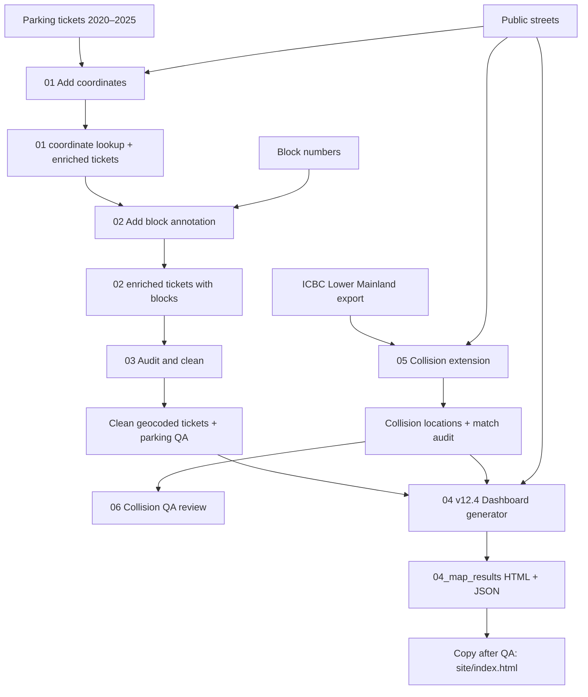

# Architecture and file dependencies

The optional `04_local_street_map.py` is an earlier standalone map prototype. It is not called by the v12.4 pipeline.

## Direct input contract for v12.4

- `data_source/processed/03_quality_results/parking_tickets_clean_geocoded.csv`: semicolon-delimited; `Block`, `Street`, `Year`, `Status`, `InfractionText`.
- `data_source/raw/public-streets.csv`: semicolon-delimited; `HBLOCK`, `Geom`.
- `data_source/processed/05_collision_results/collision_locations.csv`: includes `Latitude`, `Longitude`, `Year`, `Crashes`, `Crash Severity`, `Derived Crash Configuration`, `Pedestrian Flag`, `Cyclist Flag`, `Parked Vehicle Flag`.

All Python scripts currently locate their project root via `Path(__file__).resolve().parent`; do not move scripts without updating those paths. The Dockerfile only serves the pre-generated `site/index.html`; it does not execute the Python pipeline.
